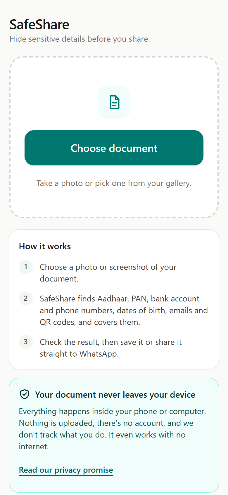
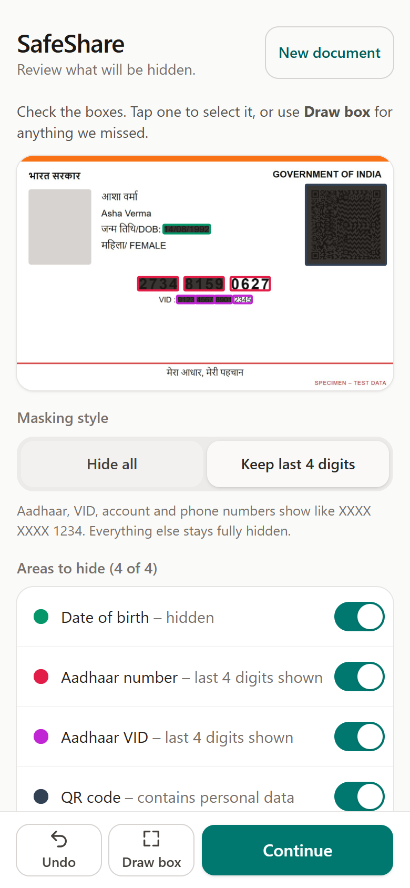
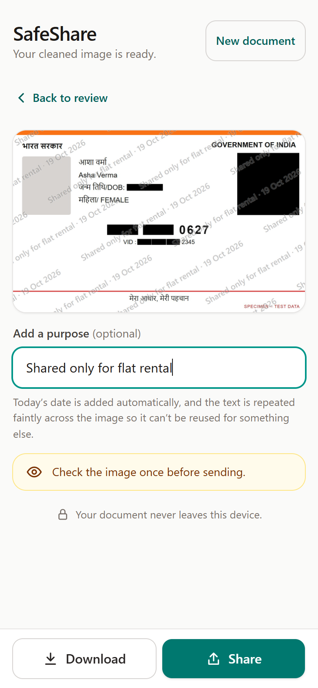

# SafeShare

**Hide Aadhaar, PAN, bank account and phone numbers on a photo of a document before you share it, without the photo ever leaving your phone.**

People in India send photos of their Aadhaar card, PAN card or passbook over WhatsApp all the time: to landlords, employers, banks, delivery agents. Those photos carry far more than the person needs, and they get forwarded and stored indefinitely. SafeShare reads the photo on your device, finds the sensitive details, covers them with solid black boxes, and gives you a clean copy to share.

Live app: _add your Vercel URL here_

<!-- Captured from the production build at 390px with a synthetic test card. Swap in real phone screenshots when you have them. -->
| Choose a photo | Review what's hidden | Share the clean copy |
| --- | --- | --- |
|  |  |  |

## What it does

1. **Choose** a photo or screenshot of a document: camera, gallery, drag-and-drop, or **Share → SafeShare** from the Android gallery once installed.
2. **SafeShare finds** Aadhaar numbers, Aadhaar VIDs, PAN, bank account numbers, IFSC codes, phone numbers, email addresses, dates of birth and QR codes, in English and Hindi.
3. **You review**: turn boxes on or off, draw your own over anything missed, undo, and choose *Hide all* or *Keep last 4 digits* (XXXX XXXX 1234).
4. **Share**: add an optional purpose watermark ("Shared only for flat rental · 19 Oct 2026"), then download or share straight to WhatsApp.

It's an installable web app (PWA) that works offline.

## Privacy design

The rule is simple: **no server, nothing leaves the device.**

- **Everything runs in the browser.** Text recognition (Tesseract.js, WebAssembly), QR finding (jsQR) and detection all run on the phone, in web workers. There is no backend and no API.
- **Enforced by the browser, not just by promise.** A strict Content-Security-Policy (`connect-src 'self'`, see `vercel.json`) means the page *cannot* send requests to any other server, even by mistake.
- **No third-party requests at all.** The OCR engine and the English + Hindi language files are served from the app itself (`public/tesseract/`), not a CDN. No web fonts, no analytics, no error reporting, no cookies, no accounts.
- **Nothing is saved.** Documents live only in memory. The only things stored on the device are the app's own files (for offline use) and, briefly, an image shared from the Android gallery, which is deleted as soon as the app opens it.
- **Solid masks, never blur.** Blur and pixelation can sometimes be reversed; black boxes can't.
- **Clean output file.** The shared image is a brand-new JPEG drawn from a canvas, so the original's EXIF metadata (GPS location, camera, time) is not carried over. Verified in a browser test with a planted EXIF block.
- **QR contents are never read.** Only a QR code's position is used, to cover it.
- **You decide when it's sent.** The image goes nowhere until you tap Download or Share.

The [About & privacy page](src/components/AboutPage.tsx) explains this to users in plain English.

## How detection works

```
photo ─► upright, ≤2000 px working copy ─┬─► OCR: Tesseract.js, English + Hindi, automatic page layout ─┐
                                          └─► QR scan: jsQR in its own worker ───────────────────────────┤
                                                                                                         ▼
                        detectors (pure TypeScript) ─► review screen ─► solid boxes on the full-resolution original ─► new JPEG
```

The detectors work on the OCR words, grouped into lines:

| Item | Rule |
| --- | --- |
| Aadhaar | 12 digits, first digit 2–9, valid **Verhoeff checksum**. Often printed as `1234 5678 9012`, so neighbouring number-like words on the same line are joined first. |
| Aadhaar VID | 16 digits after "VID" or "Virtual ID" |
| PAN | `AAAAA9999A`, 4th letter one of A B C F G H J L P T, printed in capitals |
| Bank account | 9–18 digits after "A/c", "Account", "Acct", "Acc No" or "खाता" |
| IFSC | 4 letters, `0`, then 6 letters or digits, printed in capitals |
| Phone | 10 digits starting 6–9, optional `+91`, `91` or `0` |
| Email | standard address pattern; joins addresses OCR split in two |
| Date of birth | a date (or birth year) after "DOB", "Date/Year of Birth" or "जन्म तिथि" |
| QR code | always treated as sensitive (Aadhaar QR codes hold name, address and photo) |

Details that make it work on real documents:

- **OCR look-alikes** are fixed inside number-like words: O→0, I/l→1, S→5, B→8 (and the reverse in PAN/IFSC letter positions).
- **Hindi**: text is Unicode-normalised, Devanagari digits ०–९ are read as 0–9, and every English keyword has a Hindi fallback, since mixed-language OCR sometimes misreads Latin labels (it once read "DOB" as "008").
- **Context keywords** like "A/c" or "VID" must come *before* the value and claim only the first number after them, so an Aadhaar number near an account label isn't mislabelled.
- **Overlaps**: if two rules match the same words, the longer match wins (a 16-digit VID beats a 12-digit piece of it).
- **Photo quality**: if the text was read with low confidence, the app warns that the photo looks blurry, or that no text was found.

The rules and their tests are in [`src/lib/detectors.ts`](src/lib/detectors.ts) and [`detectors.test.ts`](src/lib/detectors.test.ts).

## Test results

`npm run eval` runs every image in `tests/images/` through the real pipeline in headless Chrome and scores it against `tests/expected.json`. Full history in [`tests/results.md`](tests/results.md).

Latest run (19 Oct 2026, 10 synthetic documents):

| | Before fixes | After fixes |
| --- | --- | --- |
| **Catch rate** (items found ÷ items present) | 97.1% (33/34) | **100% (34/34)** |
| **False alarms** (boxes on harmless text) | 3 | **1** |

What the first run found, and what was changed:

- **Missed an Aadhaar number** on a card back with a large QR code. Tesseract.js uses Tesseract's default "single block of text" layout, which skipped that line entirely. Switching to automatic page layout found it. The card images also read faster in that run (e.g. 2.7 s → 1.3 s); the whole set took 14% less time.
- **"Laptop stand" read as an IFSC code** (joined, then O→0). PAN and IFSC now have to be printed in capitals.
- **A phantom QR code** in a dim photo (a 3:1 rectangle). QR boxes must now be roughly square.
- **Left as is**: the public helpline email printed on the card back gets a box. Telling public and personal emails apart isn't reliable, and an extra box is cheaper than a missed one.

> **Caveat:** these are synthetic documents rendered in a browser (made-up data, including a rotated, softened "phone photo" and a dim one). The fixes were developed against the same set. Real phone photos are harder; add photos of printed fake documents to `tests/images/` for honest numbers. See [`tests/README.md`](tests/README.md).

## Run it locally

Requirements: **Node.js 22.12+**, and Chrome or Edge for the evaluation scripts.

```sh
git clone https://github.com/anvii24/safeshare.git
cd safeshare
npm install          # also copies the OCR engine + language files into public/tesseract/
npm run dev          # http://localhost:5173
```

| Command | What it does |
| --- | --- |
| `npm run dev` | Development server (no service worker) |
| `npm run build` | Type-check and build to `dist/`, including the service worker |
| `npm run preview` | Serve the build with production security headers; use this to test offline, install and the share target |
| `npm test` | Unit tests (Vitest) |
| `npm run lint` | Lint (oxlint) |
| `npm run eval` | Detection quality report → `tests/results.md` (`-- --label "note"` to annotate) |
| `npm run make-test-images` | Regenerate the synthetic test documents |

To try it on your phone, deploy it (below). Camera access, installing and sharing all need HTTPS.

## Deploy

The repo includes `vercel.json` (build settings, security headers, caching). Import the GitHub repository at [vercel.com/new](https://vercel.com/new); there's nothing to configure, and every push to `main` redeploys. Any static host works if it sends the same headers.

## Project layout

```
src/
  App.tsx                 steps: choose → reading → review → share
  sw.ts                   service worker: offline + Android share target
  lib/pipeline.ts         photo → OCR + QR → detections (used by app and eval)
  lib/detectors.ts        detection rules
  lib/review.ts           review state, undo, mask rectangles
  lib/export.ts           full-resolution render, watermark, JPEG export
  components/             UI
scripts/                  OCR asset copy, eval, test-image generator
tests/                    test images, expected answers, results
CLAUDE.md                 project rules, conventions and progress log
```

## Limitations

- It can miss things: blurry or dark photos, handwriting, unusual layouts. The app says so and asks you to check before sending.
- Names and addresses aren't detected automatically; use **Draw box**.
- PDFs aren't supported yet (take a screenshot). iPhones can't share *to* web apps, so Share → SafeShare is Android only.
